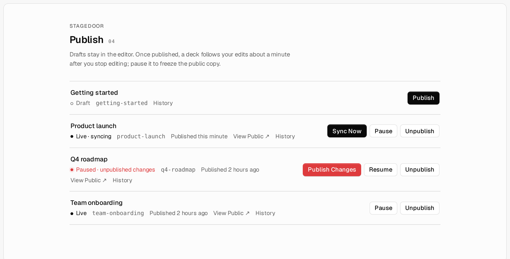
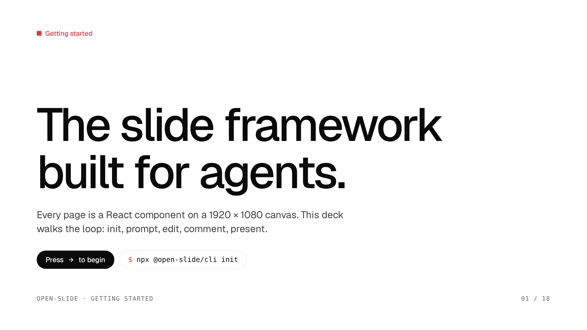
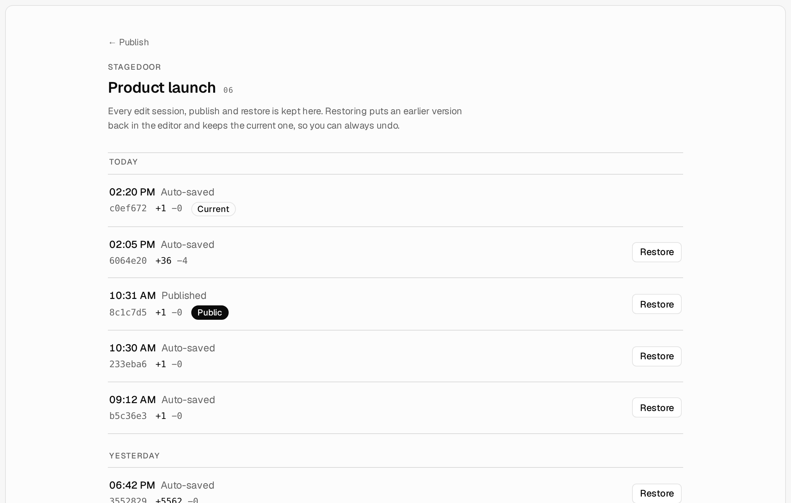
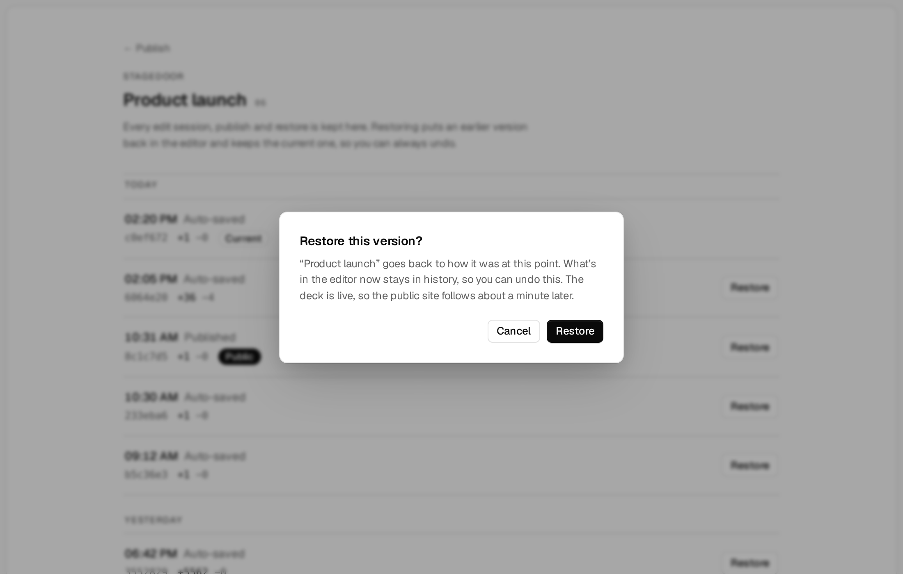

# Stagedoor

Draft, publish & restore for open-slide.

Run an [open-slide](https://github.com/open-slide/open-slide) editor on your
own server, and choose **deck by deck** what appears on a public, read-only
site. Drafts stay private; published decks follow your edits automatically,
unless you pause them. Every edit session is saved, so when an agent (or you)
breaks a deck, you can put it back.

<picture>
  <source media="(prefers-color-scheme: dark)" srcset="docs/screenshot-dark.png">
  
</picture>

> Unofficial. Not affiliated with the open-slide project.

## Why

open-slide is built for authoring on your own machine: `open-slide dev` to
edit, `open-slide build` to produce a static site of **every** deck, then
deploy. When the editor lives on a server instead, two things are missing:

- **Drafts.** A build includes every deck in `slides/`, so half-finished
  decks go public with the next build.
- **A publish step.** Rebuilding means logging in to the server.
- **A way back.** Inspector undo is cleared on save
  ([open-slide#568](https://github.com/open-slide/open-slide/issues/568)), and
  the agent panel rewinds the conversation but not the files it changed. In a
  browser there is no git to fall back on.

Stagedoor works like Google Slides' *Publish to the web*: publishing decides
*whether* a deck is public, and from then on the public copy keeps up with
the editor. Like Netlify's *Stop auto publishing*, you can pause a deck to
freeze what visitors see while you rework it. Like Google Slides' version
history, any earlier version can be restored, and restoring can be undone.

It runs next to the editor and never patches open-slide: it relies only on
the `open-slide build` CLI, the documented `slides/<id>/index.tsx` layout and
git, so open-slide upgrades don't break it.

## What you get

| Editor — `slides-edit.example.com` | Public — `slides.example.com/<deck>` |
| --- | --- |
|  |  |
| The full open-slide UI, behind your login. | Just the slides. Arrow keys and `?p=3` work; the deck list and toolbar are hidden. |

The publish page lives at `slides-edit.example.com/publish`, behind the same
login. Each deck links to its **History**:

<picture>
  <source media="(prefers-color-scheme: dark)" srcset="docs/history-dark.png">
  
</picture>

<picture>
  <source media="(prefers-color-scheme: dark)" srcset="docs/restore-dialog-dark.png">
  
</picture>

## How it works

```
                   ┌──────────────────── container ─────────────────────┐
slides-edit.…  ──► │ open-slide dev          127.0.0.1:5173  (editor)    │
  (behind Access)  │ publisher  /publish     127.0.0.1:8090              │
                   │ slides-autosave   ~/deck/slides ──► git commits     │
                   │      │ snapshot + build                             │
                   │      ▼                                              │
slides.…       ──► │ Caddy  ~/publish/current  127.0.0.1:8080  (public)  │
                   └──────────── cloudflared tunnel (outbound only) ─────┘
```

- **Publish** copies `slides/<id>` into a separate build workspace, runs
  `open-slide build` there, and atomically swaps the new release in. Only
  published decks are in the public build.
- **Live** is where a deck goes once published. When you edit it, the public
  copy updates about a minute after you stop, so half-made changes don't
  flash up mid-edit. *Sync Now* skips the wait.
- **Pause** freezes the public copy. Edits pile up as *unpublished changes*;
  *Publish Changes* pushes them once and stays paused, *Resume* goes live
  again.
- **Unpublish** removes the deck and rebuilds.
- **A failed build** rolls the snapshot back and leaves the public site as it
  was. A live deck that fails to build shows *Sync failed* and is retried
  after your next edit, not in a loop.
- **Autosave** commits `slides/` to git about 30 seconds after edits stop
  (at least every 5 minutes during long agent runs), whoever made them:
  inspector, agent panel or a text editor. Every publish is committed too and
  marked *Public*.
- **Restore** writes an earlier version back into the editor and commits it.
  What was there before is committed first, so *Undo* is one click. A live
  deck then syncs as usual; a paused one stays frozen until you publish.

| Status | Public? | Updates |
| --- | --- | --- |
| Draft | no | — |
| Live | yes | automatically, after edits settle |
| Live · syncing | yes | edits are waiting to go out |
| Paused | yes | only when you publish |
| Paused · unpublished changes | yes | editor is ahead of the public copy |
| Deleted in editor | yes | gone from the editor; unpublish to remove |

## Install

Tested on Ubuntu 24.04 in an unprivileged Proxmox LXC container. Any
Debian/Ubuntu container or VM works the same way. Give it a machine of its
own: the editor's agent panel can run commands in it.

1. **Run the installer** as root in the container:

   ```sh
   git clone https://github.com/Stanley1106/stagedoor /opt/stagedoor-src
   cd /opt/stagedoor-src
   EDIT_HOST=slides-edit.example.com PUBLIC_HOST=slides.example.com ./deploy/install.sh
   ```

   It installs Node 22, Caddy, cloudflared and inotify-tools, creates a
   `slide` user with an open-slide workspace (a git repository) in `~/deck`,
   and starts the editor, the publisher, autosave and Caddy, all on
   `127.0.0.1` only. Re-running it updates Stagedoor and keeps your workspace,
   config, history and published decks.

2. **Create a Cloudflare Tunnel** (Zero Trust → Networks → Tunnels), then
   store its token in the container and start it:

   ```sh
   install -m 600 /dev/null /etc/cloudflared/tunnel.env
   echo 'TUNNEL_TOKEN=<token>' > /etc/cloudflared/tunnel.env
   systemctl enable --now cloudflared
   ```

3. **Add public hostnames** to the tunnel, in this order:

   | Hostname | Path | Service |
   | --- | --- | --- |
   | `slides-edit.example.com` | `^/publish(/\|$)` | `http://127.0.0.1:8090` |
   | `slides-edit.example.com` | | `http://127.0.0.1:5173` |
   | `slides.example.com` | | `http://127.0.0.1:8080` |

4. **Protect the editor.** Add a Cloudflare Access application for
   `slides-edit.example.com` that only lets you in. It covers `/publish` too.
   Set this up before the hostname goes live: the editor can write files and
   run an agent.

The tunnel only makes outbound connections, so this works behind NAT and
campus or office firewalls. The cloudflared unit uses HTTP/2 over IPv4,
which connects right away on networks that block QUIC (UDP 7844).

### Reference deployment

The installer, Caddyfile and tunnel steps are one tested way to run
Stagedoor, not a requirement. The publisher only needs a workspace, a data
directory and something in front that authenticates `/publish`.

### Proxmox notes

`deploy/pve/` has the host-side files from the reference setup: a private NAT
bridge (`vmbr2`, `10.20.20.0/24`) so the container doesn't need a public IP.
If your network blocks outside DNS, point the container at your local
resolvers with `pct set <vmid> --nameserver "<ip> <ip>"`.

## Use

| | |
| --- | --- |
| Edit | `https://slides-edit.example.com` |
| Publish | `https://slides-edit.example.com/publish` |
| History | `https://slides-edit.example.com/publish/history/<deck-id>` |
| Share | `https://slides.example.com/<deck-id>` — redirects to `/s/<deck-id>`; add `?p=3` to open page 3 |

The same actions from a shell in the container:

```sh
runuser -u slide -- bash -c 'set -a; . /etc/stagedoor/publisher.env
  cd /opt/stagedoor && python3 -m publisher status'
```

Commands: `status`, `publish <id>...`, `unpublish <id>...`, `pause <id>...`,
`resume <id>...`, `sync` (push pending edits of live decks now), `history <id>`,
`restore <id> <rev>` and `rebuild`.

## Configuration

The publisher reads `/etc/stagedoor/publisher.env`:

| Variable | Default | |
| --- | --- | --- |
| `STAGEDOOR_WORKSPACE` | — | the open-slide workspace the editor uses |
| `STAGEDOOR_DATA_DIR` | — | snapshots, releases and the `current` symlink |
| `STAGEDOOR_LISTEN` | `127.0.0.1:8090` | |
| `STAGEDOOR_BASE_PATH` | `/publish` | must match the tunnel path rule |
| `STAGEDOOR_PUBLIC_URL` | — | e.g. `https://slides.example.com/s/{id}`, for *View Public* links |
| `STAGEDOOR_BUILD_CMD` | `npx --no-install open-slide build --out-dir {out}` | |
| `STAGEDOOR_SYNC_DELAY` | `60` | seconds a live deck must sit unedited before it syncs |

The public build hides open-slide's deck browser and toolbar through the
`build` options in `open-slide.config.ts`; the installer sets them for new
workspaces.

Autosave reads `QUIET` (default `30`) and `MAX_WAIT` (default `300`) seconds
from its systemd unit.

## Scope

Stagedoor controls **what is public** and **gets you back** from a bad edit.

| In scope | Not in scope |
| --- | --- |
| Drafts, publish, unpublish, live sync, pause | Editing slides: that's open-slide |
| Atomic, rolled-back builds; short public links | Undo inside the editor ([open-slide#568](https://github.com/open-slide/open-slide/issues/568)) |
| Versions saved after each edit session and publish | Previews of old versions: restore, check in the editor, undo if wrong |
| Restore and undo, from the browser or the CLI | Accounts and permissions: use Cloudflare Access or similar |
| | Patching or forking open-slide |

## Limitations

- `themes/` and `assets/` are shared by every deck and are copied on each
  build. Editing a shared theme reaches the public site the next time *any*
  deck is published or synced, and doesn't by itself trigger a sync.
- The editor finds decks when it starts. If you copy a deck folder into
  `slides/` from outside the editor, restart it with
  `systemctl restart openslide-dev`.
- One build runs at a time; a publish takes a few seconds.
- History covers `slides/<id>`. Shared `themes/` and `assets/` are not
  versioned per deck.
- Edits made in the last ~30 seconds aren't in history yet; the History page
  says so when that's the case.

## Upgrading open-slide

```sh
su - slide -c 'cd deck && npm update @open-slide/core'
systemctl restart openslide-dev
```

Published decks keep serving their last build until you republish them.

## Development

Python 3.10+ and nothing else.

```sh
python3 -m unittest discover -s tests -t .
STAGEDOOR_WORKSPACE=~/my-deck STAGEDOOR_DATA_DIR=/tmp/stagedoor python3 -m publisher   # http://127.0.0.1:8090/publish/
```

Commits follow [Conventional Commits](https://www.conventionalcommits.org/),
like open-slide itself: `feat(publisher): …`, `fix(deploy): …`, `docs: …`.

## License

[MIT](LICENSE)
