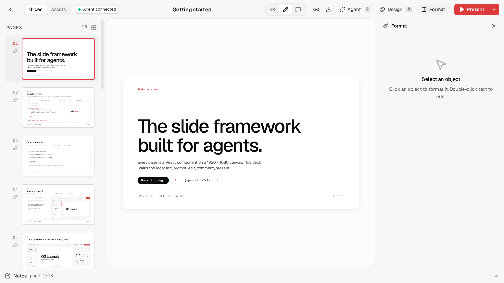

# Stagedoor

Draft & publish for open-slide.

Run an [open-slide](https://github.com/open-slide/open-slide) editor on your
own server, and publish decks to a public, read-only site **one deck at a
time**. Edits stay private until you press Publish.

<picture>
  <source media="(prefers-color-scheme: dark)" srcset="docs/screenshot-dark.png">
  
</picture>

> Unofficial. Not affiliated with the open-slide project.

## Why

open-slide is built for authoring on your own machine: `open-slide dev` to
edit, `open-slide build` to produce a static site of **every** deck, then
deploy. When the editor lives on a server instead, two things are missing:

- **Drafts.** A build includes every deck in `slides/`, so half-finished
  decks go public with the next build.
- **A publish step.** Rebuilding means logging in to the server.

This repo adds a small publisher next to the editor. It does not patch
open-slide; it only relies on the `open-slide build` CLI and the documented
`slides/<id>/index.tsx` layout, so open-slide upgrades don't break it.

## What you get

| Editor — `slides-edit.example.com` | Public — `slides.example.com/<deck>` |
| --- | --- |
|  |  |
| The full open-slide UI, behind your login. | Just the slides. Arrow keys and `?p=3` work; the deck list and toolbar are hidden. |

The publish page lives at `slides-edit.example.com/publish`, behind the same
login.

## How it works

```
                   ┌──────────────────── container ─────────────────────┐
slides-edit.…  ──► │ open-slide dev          127.0.0.1:5173  (editor)    │
  (behind Access)  │ publisher  /publish     127.0.0.1:8090              │
                   │      │ snapshot + build                             │
                   │      ▼                                              │
slides.…       ──► │ Caddy  ~/publish/current  127.0.0.1:8080  (public)  │
                   └──────────── cloudflared tunnel (outbound only) ─────┘
```

- **Publish** copies `slides/<id>` into a separate build workspace, runs
  `open-slide build` there, and atomically swaps the new release in. Only
  published decks are in the public build.
- **Keep editing** after publishing: the public copy doesn't change until you
  publish again. The page shows *Unpublished changes* meanwhile.
- **Unpublish** removes the deck and rebuilds.
- **A failed build** rolls the snapshot back, leaves the public site as it
  was, and shows the build log.

Statuses: **Draft** (never published) · **Published** · **Unpublished
changes** · **Deleted in editor** (still public, gone from the editor).

## Install

Tested on Ubuntu 24.04 in an unprivileged Proxmox LXC container. Any
Debian/Ubuntu container or VM works the same way. Give it a machine of its
own: the editor's agent panel can run commands in it.

1. **Run the installer** as root in the container:

   ```sh
   git clone https://github.com/Stanley1106/stagedoor /opt/stagedoor-src
   cd /opt/stagedoor-src
   EDIT_HOST=slides-edit.example.com PUBLIC_HOST=slides.example.com ./deploy/install.sh
   ```

   It installs Node 22, Caddy and cloudflared, creates a `slide` user with an
   open-slide workspace in `~/deck`, and starts three services, all listening
   on `127.0.0.1` only. Re-running it updates the publisher and keeps your
   workspace, config and published decks.

2. **Create a Cloudflare Tunnel** (Zero Trust → Networks → Tunnels), then
   store its token in the container and start it:

   ```sh
   install -m 600 /dev/null /etc/cloudflared/tunnel.env
   echo 'TUNNEL_TOKEN=<token>' > /etc/cloudflared/tunnel.env
   systemctl enable --now cloudflared
   ```

3. **Add public hostnames** to the tunnel, in this order:

   | Hostname | Path | Service |
   | --- | --- | --- |
   | `slides-edit.example.com` | `^/publish(/\|$)` | `http://127.0.0.1:8090` |
   | `slides-edit.example.com` | | `http://127.0.0.1:5173` |
   | `slides.example.com` | | `http://127.0.0.1:8080` |

4. **Protect the editor.** Add a Cloudflare Access application for
   `slides-edit.example.com` that only lets you in. It covers `/publish` too.
   Set this up before the hostname goes live: the editor can write files and
   run an agent.

The tunnel only makes outbound connections, so this works behind NAT and
campus or office firewalls. The cloudflared unit uses HTTP/2 over IPv4,
which connects right away on networks that block QUIC (UDP 7844).

### Proxmox notes

`deploy/pve/` has the host-side files from the reference setup: a private NAT
bridge (`vmbr2`, `10.20.20.0/24`) so the container doesn't need a public IP.
If your network blocks outside DNS, point the container at your local
resolvers with `pct set <vmid> --nameserver "<ip> <ip>"`.

## Use

| | |
| --- | --- |
| Edit | `https://slides-edit.example.com` |
| Publish | `https://slides-edit.example.com/publish` |
| Share | `https://slides.example.com/<deck-id>` — redirects to `/s/<deck-id>`; add `?p=3` to open page 3 |

The same actions from a shell in the container:

```sh
runuser -u slide -- bash -c 'set -a; . /etc/stagedoor/publisher.env
  cd /opt/stagedoor && python3 -m publisher status'
```

`status`, `publish <id>...`, `unpublish <id>...` and `rebuild` are available.

## Configuration

The publisher reads `/etc/stagedoor/publisher.env`:

| Variable | Default | |
| --- | --- | --- |
| `STAGEDOOR_WORKSPACE` | — | the open-slide workspace the editor uses |
| `STAGEDOOR_DATA_DIR` | — | snapshots, releases and the `current` symlink |
| `STAGEDOOR_LISTEN` | `127.0.0.1:8090` | |
| `STAGEDOOR_BASE_PATH` | `/publish` | must match the tunnel path rule |
| `STAGEDOOR_PUBLIC_URL` | — | e.g. `https://slides.example.com/s/{id}`, for *View Public* links |
| `STAGEDOOR_BUILD_CMD` | `npx --no-install open-slide build --out-dir {out}` | |

The public build hides open-slide's deck browser and toolbar through the
`build` options in `open-slide.config.ts`; the installer sets them for new
workspaces.

## Limitations

- `themes/` and `assets/` are shared by every deck and are copied on each
  publish. Editing a shared theme reaches the public site the next time
  *any* deck is published.
- The editor finds decks when it starts. If you copy a deck folder into
  `slides/` from outside the editor, restart it with
  `systemctl restart openslide-dev`.
- One build runs at a time; a publish takes a few seconds.

## Upgrading open-slide

```sh
su - slide -c 'cd deck && npm update @open-slide/core'
systemctl restart openslide-dev
```

Published decks keep serving their last build until you republish them.

## Development

Python 3.10+ and nothing else.

```sh
python3 -m unittest discover -s tests -t .
STAGEDOOR_WORKSPACE=~/my-deck STAGEDOOR_DATA_DIR=/tmp/stagedoor python3 -m publisher   # http://127.0.0.1:8090/publish/
```

Commits follow [Conventional Commits](https://www.conventionalcommits.org/),
like open-slide itself: `feat(publisher): …`, `fix(deploy): …`, `docs: …`.

## License

[MIT](LICENSE)
